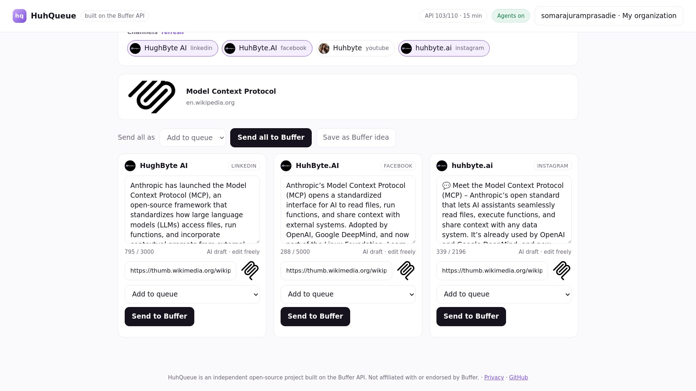

# HuhQueue Studio — built on the Buffer API

**Paste a link. Get a post for every channel. Approve it, and it's in your Buffer queue.**
An open-source, agent-first content studio. Your AI agents (Claude, ChatGPT, Cursor) can draft and schedule through it too —
but nothing they write goes out until you approve it.

**Live:** https://huhqueue-studio.onrender.com · **Buffer Commit entry:** see [CONTEST.md](CONTEST.md) and [SUBMISSION.md](SUBMISSION.md)

> HuhQueue is an independent open-source project built on the [Buffer API](https://developers.buffer.com). It is not made, endorsed or operated by Buffer.



## Why

Creators who share news (we run a daily AI-news page) do the same chore many times a day: read the story, write a LinkedIn version,
a shorter X version, an Instagram caption with "link in bio", check each network's limit, then queue them. Agents can write those
posts in seconds, but nobody wants an agent posting to their brand unreviewed. HuhQueue is the review desk between the two, on top of
the Buffer account you already use.

## What it does

- **Connect Buffer** — OAuth 2.0 Authorization Code + PKCE with a private client. Access and rotating refresh tokens stay encrypted on the server; the browser only holds an opaque session cookie.
- **Link → drafts** — reads the article and writes one caption per channel, counted the way Buffer counts (UTF-16, LinkedIn URLs = 24, Instagram line breaks = 2, X URLs = 23, Bluesky graphemes) and trimmed to fit.
- **Send to Buffer** — as a Buffer draft, add to queue, share next, share now or a custom time; image/video by URL; ideas to your Ideas board. Queue and drafts read back from Buffer.
- **Agents with a leash** — MCP server + REST API per Buffer user. Every write is *preview → single-use confirm token → submit*. Default policy holds agent posts in an **Approvals inbox**; `draft` tokens can only create Buffer drafts; `trusted` tokens can schedule. Daily caps, a one-click **kill switch**, and an **activity log** of every action by you or your agents.
- **Plays nice with Buffer's limits** — reads `RateLimit` headers (shown live in the header), caches channel lists, backs off on `429` + `Retry-After`.

## Connect an agent (MCP)

Create a token in **Agents**, then:

```bash
claude mcp add --transport http huhqueue https://huhqueue-studio.onrender.com/mcp \
  --header "Authorization: Bearer hq_YOUR_TOKEN"
```

Tools: `whoami`, `list_channels`, `draft_from_link`, `preview_post`, `submit_post`, `list_approvals`, `list_queue`, `create_idea`, `get_limits`.
The REST API (`/api/docs`) accepts the same bearer token, so UI = API = MCP (a test asserts all three send Buffer the identical `createPost` input).

## Run it yourself

```bash
pip install -r requirements-studio.txt
cp .env.example .env   # BUFFER_CLIENT_ID / BUFFER_CLIENT_SECRET from https://publish.buffer.com/settings/api, redirect https://localhost:8000/callback
export $(grep -v '^#' .env | xargs) && uvicorn studio.app:create_app --factory --port 8000 --ssl-keyfile key.pem --ssl-certfile cert.pem
```

Production: `render.yaml` (free web service + free Postgres) or `Dockerfile.studio` anywhere. Set `DATABASE_URL` to Postgres so rotating refresh tokens survive restarts.
Optional `AI_BASE_URL`/`AI_MODEL`/`AI_API_KEY` point the drafter at any OpenAI-compatible model; the hosted demo uses the free Pollinations endpoint and falls back to the built-in writer.

## Tests

```bash
pip install -r requirements.txt -r requirements-dev.txt -r requirements-studio.txt
python -m pytest tests/studio -q            # API, OAuth, rate limits, safety, parity + Playwright e2e
STUDIO_TEST_PG=postgresql://... python -m pytest tests/studio -q   # same suite on Postgres
scripts/secret_scan.sh                      # gitleaks on full history + working tree (run before every push)
```

## Self-hosted mode

The pre-existing HuhQueue scheduler with native connectors (no Buffer needed) is in `huhqueue/` — see [docs/SELF_HOST.md](docs/SELF_HOST.md).
It is not part of the contest edition.

MIT licensed. Built fast with AI coding agents; any agent can read, edit and run this repo.
