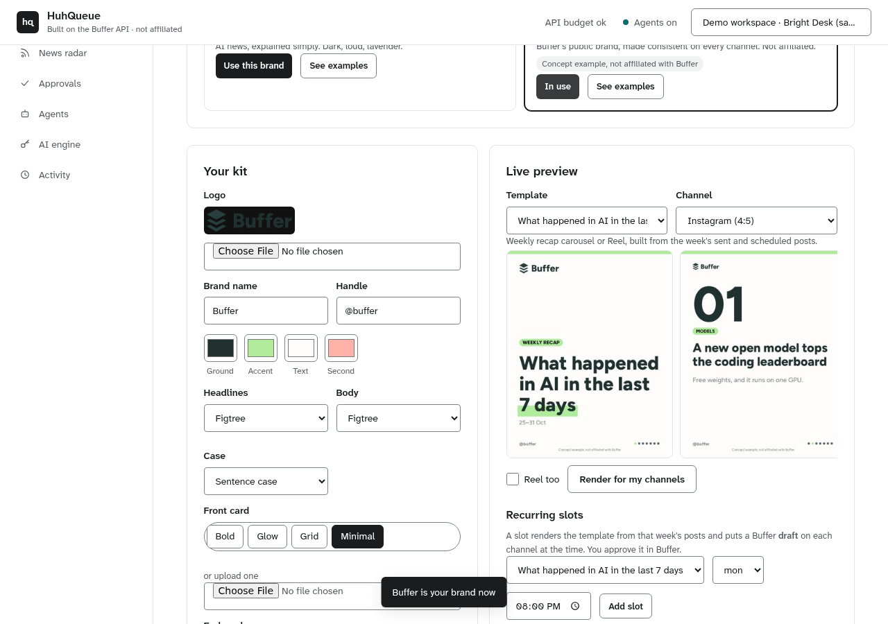
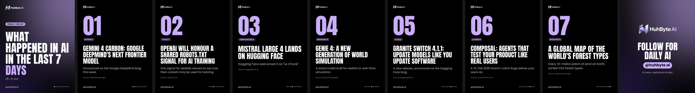
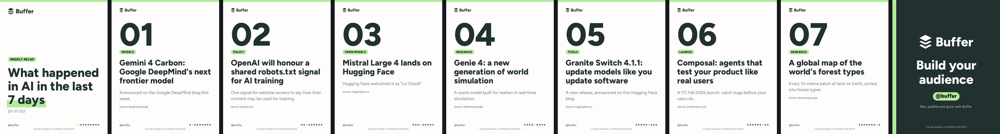
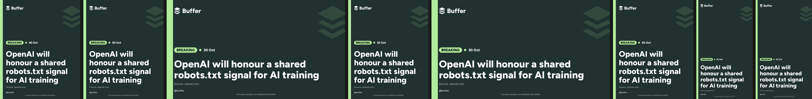
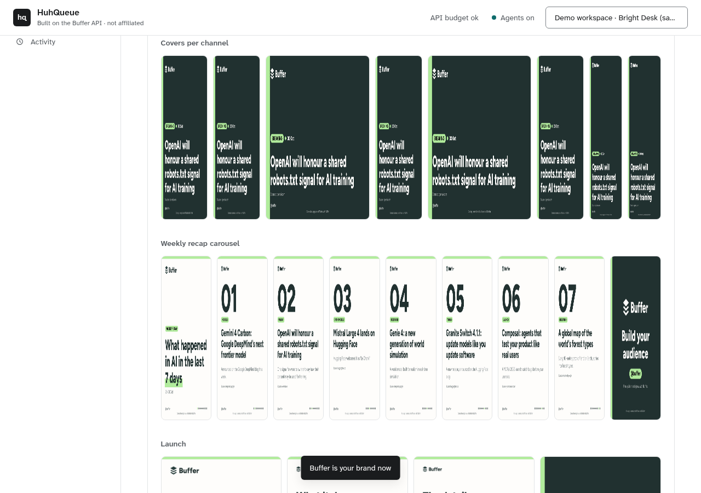

# Brand studio: kits, front and end cards, templates, example brands

The Brand studio (More → **Brand studio**, `studio/brand_studio.py`, `studio/templates.py`) makes one brand look the same on
every channel without redesigning anything per network.

## The kit

Logo, name, handle, four colours (ground, accent, text, second), a headline font (Anton, Poppins, Inter, Figtree) and a body
font, headline case, a **front card** and an **end card**. Each card is either an uploaded image or a style:

| Style | Look |
|---|---|
| `bold` | Solid ground, a thick accent bar, the headline set big |
| `glow` | Dark ground with a soft accent glow behind the headline |
| `grid` | A fine grid, like an editor's layout sheet |
| `minimal` | Light ground, dark text, the accent as a marker-pen highlight |

Guards: text that would not read on the ground (contrast under 3:1) falls back to black or white; a dark logo on a dark card
(or a light one on a light card) is recoloured to the ink; glyphs a font cannot draw are replaced, never shown as boxes.

**First-run path**: upload logo → pick a style → see examples → connect Buffer, shown as four steps at the top of the screen.
The live preview redraws the selected template at the selected channel's frame 300 ms after each edit, with the unsaved
changes laid over the saved kit (`POST /api/brand-studio/preview`, small JPEGs as `data:` URLs, nothing stored).

## Templates

Every template puts the brand's front card first and its end card last.

| Template | What it is | Video |
|---|---|---|
| `weekly_recap` | "What happened in AI in the last 7 days": one numbered slide per story, built from the week's **sent and scheduled** Buffer posts (the same story on four channels counts once) | Reel |
| `midweek_recap` | Monday to Wednesday in three stories | Reel |
| `breaking` | Breaking-news cover: BREAKING pill, time, headline, source, a faint copy of the brand mark | — |
| `launch` | Launch / product carousel: what it does, the details, why it matters | Reel |
| `quote` | Quote / CEO card, and a 9:16 clip with word-by-word captions in the brand font | Captioned clip |
| `tutorial` | "Free way to do X": a free tool and numbered steps | Reel |

Per channel (`templates.CHANNELS`): Instagram, LinkedIn, Threads, Facebook 4:5; X, Bluesky, Mastodon 16:9; YouTube Shorts
and TikTok 9:16 (video only). Slide caps follow the network (X and Bluesky 4, LinkedIn 9, Instagram 10); when a carousel is
cut, the end card stays last. Reels are silent on purpose (add licensed music in the network's app); where the crossfade chain
runs out of memory the Reel falls back to hard cuts.

**Recurring Planner slots** (`POST /api/templates/slots`, MCP `schedule_template_slot`): e.g. weekly recap every Monday
20:00 Europe/Dublin. When a slot fires it renders the template from that week's posts and puts one **Buffer draft** per
channel at the slot time, with the slides attached. A person approves it in Buffer (or in Approvals for an agent token).
Slots fire from "Run now" (it drafts the slot's next time) or, on the hosted app, from a ticker that is opt-in (`HQ_SLOT_TICK=1`, every `HQ_SLOT_TICK_S` seconds, default 300) and never runs for the sample or an account whose kill switch is on. The ticker makes the drafts up to `HQ_SLOT_LEAD_MIN` (default 60) minutes before the slot so they wait in Buffer at the time; the slot's time follows its own zone (Mon 20:00 Europe/Dublin is 20:00 UTC in winter, 19:00 UTC in summer). Each (slot, occurrence, channel) is claimed in `template_slot_runs` before Buffer is called, so a retry, a restart or two instances during a deploy never make a second draft. A slot the server slept through by under 12 hours drafts 10 minutes out; longer, it is skipped. `/healthz` `slots` shows the ticker is on and when it last ran.

## The two example brands (sample workspace)

Switch from the Example brands row; each has a gallery of pre-rendered outputs (`studio/static/examples/<brand>/`, rendered by
`scripts/render_brand_examples.py` from the recorded Sources fixtures of 31 Oct 2026).

**HuhByte AI**: logo from [dataanalystram/Huhbyte.ai](https://github.com/dataanalystram/Huhbyte.ai) `code/brand/logo.png`,
black ground, lavender `#C9ACFA`, Anton headlines, Poppins body; Instagram, YouTube Shorts, X, LinkedIn.

**Buffer (concept example, not affiliated with Buffer)**: Buffer's public brand as buffer.com serves it today: the layered
mark from `buffer.com/img/logos/buffer-logo.png` with a Figtree wordmark, and the palette from the site's own CSS tokens
(`--color-brand-dark` hsl(176 20% 16%) = `#213130`, `--color-brand-primary` hsl(105 68% 77%) = `#B0EC9C`, coral
hsl(7 100% 83%) = `#FFB2A8`, neutral-050 `#FEFDFB`). Figtree is a font buffer.com loads (SIL OFL 1.1). Every Buffer render
carries "Concept example, not affiliated with Buffer". Channels: Instagram, LinkedIn, X, Threads, Bluesky, Facebook, TikTok,
YouTube Shorts. Same stories, same templates as HuhByte: the point is that a brand change is one click, and every channel
follows.

## API and MCP

| UI | REST | MCP |
|---|---|---|
| Load the screen | `GET /api/brand-studio` | `get_brand`, `list_templates`, `list_brand_examples` |
| Save kit / cards | `POST /api/brand-studio` | — (people only in the UI; agents use `remember_rule`) |
| Live preview | `POST /api/brand-studio/preview` | — |
| Use an example brand | `POST /api/brand-studio/examples/{huhbyte,buffer}` | `apply_brand_example` |
| Render for my channels | `POST /api/templates/render` | `render_template` |
| Recap stories from posts | `GET /api/templates/recap?template=weekly_recap` | (inside `render_template`) |
| Recurring slots | `GET/POST /api/templates/slots`, `PATCH/DELETE /api/templates/slots/{id}`, `POST /api/templates/slots/{id}/run` | `schedule_template_slot`, `templates_slot_run` |

Every write answers with `buffer_cost` (`{"requests": n, "live": true}`): the real Buffer GraphQL requests the action made on a
connected account (0 in the sample, which has no Buffer behind it).

Limits: renders are in-process with Pillow; video needs FFmpeg, which the hosted web instance does not have, so the hosted app
renders slides live and shows the pre-rendered example Reels (self-hosted installs and CI render video). The sample's renders
count against its daily "run" cap and it never renders video live.
