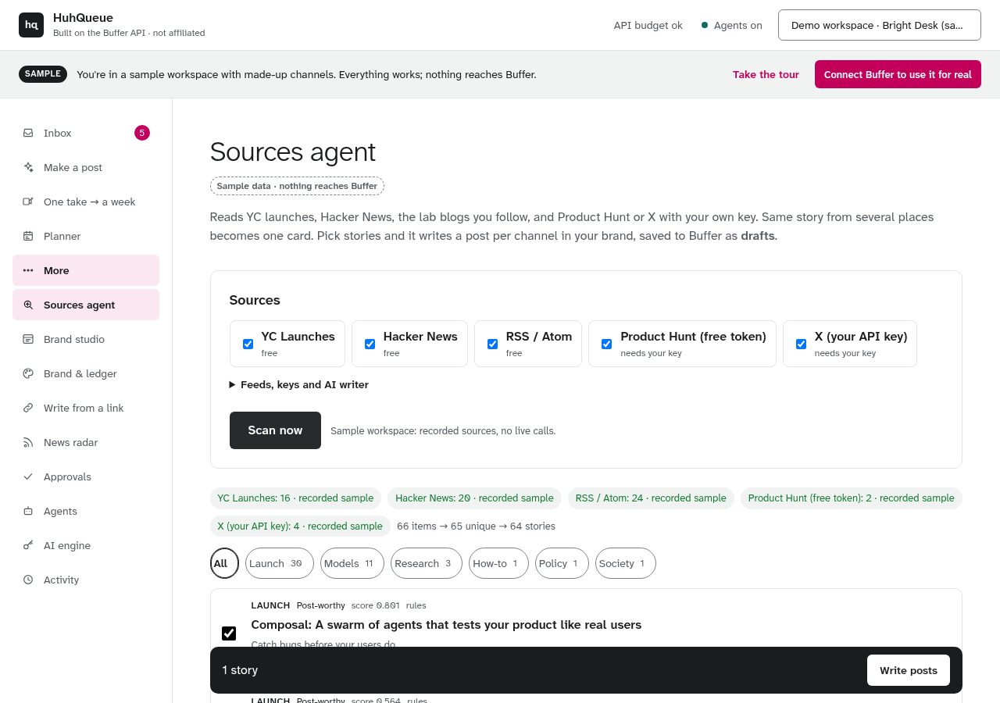
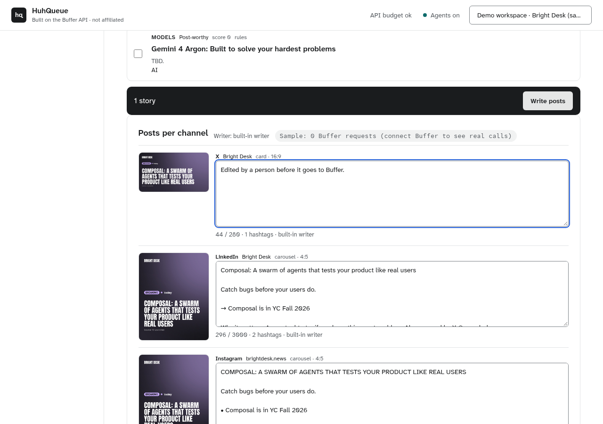

# The Sources agent

More → **Sources agent** (`studio/sources_agent.py`). It finds news, rewrites it in the brand for each channel, and saves it
to Buffer as **drafts** a person approves. Nothing it does publishes.

## What existed before, and what this adds

| Before (still there) | Added |
|---|---|
| News radar: follow up to 12 RSS/Atom feeds, newest first (`studio/radar.py`) | Pluggable adapters: **YC Launches**, **Hacker News** front page, **RSS/Atom** lab blogs, **Product Hunt** (free developer token), **X** (the user's own API key only) |
| "Make a post" agent: one topic or link → research → one story → render → captions (`studio/house.py`) | Many sources at once → **dedupe** (canonical URL, same title) → **topic clusters** (the same story from several sources is one card, "also on …") |
| Search leads from Bing News, HN search, followed feeds (`studio/sources.py`) | Judgments and decisions per cluster (the News radar classifier design): Jev first, then SubQ, then rules; lanes and agent permissions decided in code |
| Captions per channel within Buffer's limits (`studio/drafter.py`) | Channel-shaped posts (length target, hashtag count, format, frame) with a breaking cover rendered in the brand kit per frame, editable before saving, saved as **Buffer drafts** |

## Sources (no paid keys)

| Adapter | How it reads | Key |
|---|---|---|
| `yc` | `https://www.ycombinator.com/launches` with `Accept: application/json` (public) | none |
| `hn` | `https://hn.algolia.com/api/v1/search?tags=front_page` (Algolia's free HN API) | none |
| `rss` | the feeds you list (defaults: OpenAI, Google DeepMind, Hugging Face, Google AI blogs), up to 8 | none |
| `ph` | Product Hunt API v2 GraphQL, today's top launches | your free developer token |
| `x` | X API v2 recent search with your query | your own bearer token; logged-in X is never scraped |

Every live fetch goes through the safe-fetch helper (`netguard.safe_get`; POSTs through `netguard.safe_post`): no automatic
redirects, every hop's host re-checked, byte caps. Keys are sealed at rest with the store's keyring, shown only as their last
four characters, and only a person (never an agent token) can add or remove them. Real accounts get 30 live scans a day.

## Judging and deciding

The model makes judgments, code makes decisions (`plans/premium_ui/RADAR_CLASSIFIER.md`). Each cluster's lead story gets one
System One request (about AI?, topic, kind, relevance, unconfirmed, sensitive, allegation) from **Jev**, then **SubQ** if Jev
fails, using the app's keys, capped at 150 judged stories per account per day (`HQ_JUDGE_CAP`), at most 16 per scan. Past the
cap, without keys, or in the sample, the deterministic **rules** answer (each card says which judged it). Code then decides:

* lane: `postable`, `idea_bank` (evergreen), `low`, `hidden` (off-topic HN/X);
* agent permission: `person_only` (sensitive or an allegation: an agent may not draft it), `verify_first` (unconfirmed, or a
  single X post), `agent_ok`;
* rank: relevance, freshness over 7 days, engagement, and how many sources carry it; made-up sample posts never outrank
  recorded real stories.

## Writing and drafting

**Write posts** (dry run) returns one package per chosen channel: the caption in the channel's shape (X: headline, one line,
link, one tag; LinkedIn: hook, arrows, why it matters, source; Instagram: headline, bullets, "link in bio", up to 5 tags;
YouTube/TikTok: title-first with the source; Bluesky: no tags), the brand's Style Ledger text rules applied, fitted to Buffer's
character count, and a breaking cover in the brand at the channel's frame. The writer is the person's **own AI key** when set
(OpenRouter, Anthropic, OpenAI and other presets in AI engine; sealed with the keyring), else the app's capped starter model,
else the built-in writer. **Save as Buffer drafts** sends exactly what was previewed (plus any edits) through
`preview_post → submit_post` with `mode: draft`, so an agent token's policy still holds (`review` waits in Approvals).

Each action reports its **Buffer request cost** (`buffer_cost.requests`): the real GraphQL requests made on a connected
account. The sample makes none and says so.

## The sample (`/demo`)

Recorded fixtures only (`studio/sample_sources/raw/`, recorded 31 Oct 2026: YC Launches, the HN front page, four lab feeds;
Product Hunt and X are made-up items in the APIs' response shapes, each titled "Sample:"). No live calls, deterministic
clusters, drafts go to the sample's in-memory Buffer.

## API and MCP

| UI | REST | MCP |
|---|---|---|
| Settings | `GET /api/sources`, `POST /api/sources/settings` | `sources_settings` |
| Scan now | `POST /api/sources/scan` | `sources_scan` |
| A past scan | `GET /api/sources/runs/{id}` | — |
| Write posts / Save as Buffer drafts | `POST /api/sources/draft` (`dry_run`, `cluster_ids`, `channel_ids`, `texts`) | `sources_draft` |

## Keys: Settings → Integrations

Keys for Product Hunt (`ph_token`), X (`x_bearer`) and the YouTube Data API (`yt_key`) are added in **Settings → Integrations**
(`studio/integrations.py`, `GET/POST/DELETE /api/integrations[/{key}[/test]]`). They live in the same sealed per-user secret
the adapters read (`source_settings.secret`, Fernet via `Store.seal`), are never returned to the browser (only `…abcd`), and
only a signed-in person can add, test or remove them. Test is a live, rate-capped check that reports a status only.

Product Hunt application Redirect URI: `https://huhqueue-studio.onrender.com/integrations/producthunt/callback`. Without
`PH_CLIENT_ID`/`PH_CLIENT_SECRET` that page tells the person to copy the Developer Token (Create Token) and paste it in the
card. With them set, `/integrations/producthunt/connect` runs the OAuth code flow with a single-use state cookie and the
callback exchanges the code (`POST https://api.producthunt.com/v2/oauth/token`) and stores the token for that person; a code
without our state is never exchanged.

## App-level research keys (nothing for users to add)

Research keys belong to HuhQueue, not to each person (judges never sign in to Product Hunt or X). `studio/appkeys.py`:

- **Product Hunt**: with `PH_CLIENT_ID`/`PH_CLIENT_SECRET` on the server, an app token from Product Hunt's OAuth
  `client_credentials` grant (`POST https://api.producthunt.com/v2/oauth/token`) is cached in memory until it expires.
  Today's launches are read once for everyone and cached for 20 minutes; live fetches are rate-limited globally (one per
  2 minutes). Without the env keys, or when the API errors, the public feed `https://www.producthunt.com/feed` is read
  instead. A person's own developer token (Settings → Integrations) is an optional override.
  **Product Hunt's API is for non-commercial use by default.** That is fine for the contest; get Product Hunt's
  permission before any commercial launch.
- **X**: no key needed (below). `X_BEARER_TOKEN`, if ever set, and a person's own bearer are optional overrides for media.

Settings → Integrations shows each app-level status ("Product Hunt: Connected by HuhQueue ✓", "X: works without a key
(public embeds)") and every callback/redirect URL with a Copy button: the Product Hunt Redirect URI (`PH_REDIRECT_URI` when
set), the Buffer Callback URL (`/callback`), the MCP server URL (`/mcp`) and MCP OAuth discovery.

## The free X reader (`studio/xreader.py`)

One public post a person links, read without an X API key, through a cascade (each layer behind netguard, results
cached globally for 20 minutes per post, live lookups capped at 60 per 15 minutes):

1. **oEmbed** `publish.x.com/oembed` (X's official embed): author and words.
2. **Syndication** `cdn.syndication.twimg.com/tweet-result?id=…&token=…`: the public endpoint X's own embeds use, as read
   by Vercel's MIT-licensed react-tweet (token computed exactly like react-tweet's `getToken`): created_at, photos, video
   variants + poster, quoted post.
3. **FxTwitter** `api.fxtwitter.com/status/<id>` (MIT FixTweet project): full text of long posts and media URLs when
   the syndication answer has none.
4. **yt-dlp** on the render worker downloads the video with only its Twitter extractor (guest token), from the post URL
   kept on each video as `source_page` (`studio/media/download.py`).

**Caveats.** Layers 2-3 are unofficial public endpoints: they can change or break without notice. X's Terms restrict
scraping; HuhQueue only reads the single public post a person links, on demand, and never crawls, searches or
bulk-collects X. `scripts/x_reader_smoke.py` checks each layer live on one public post and prints status only.
